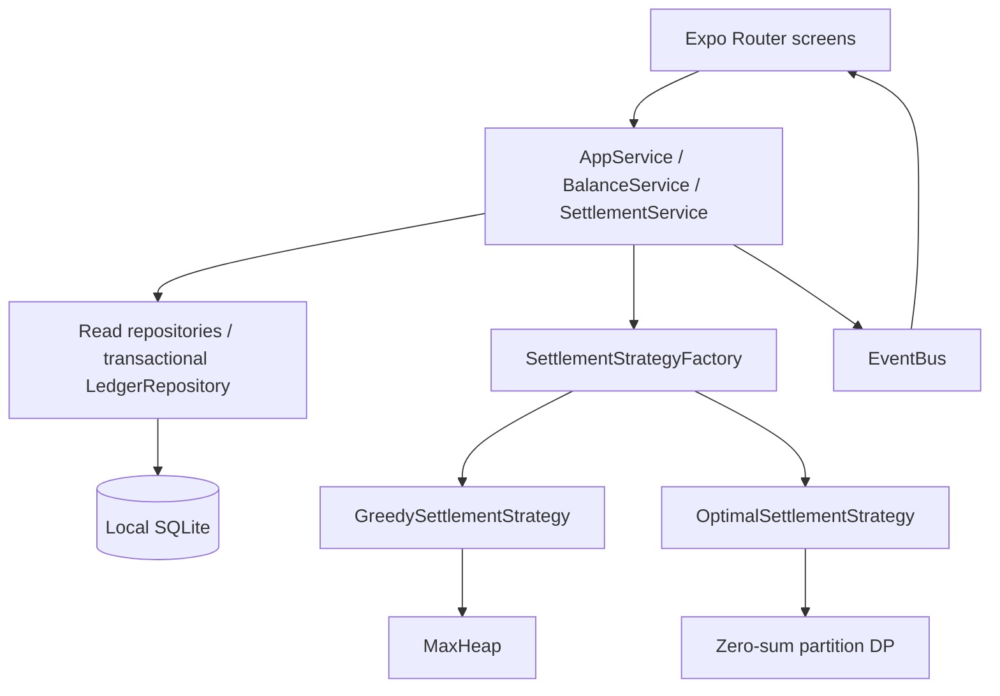

# SettleSmart

**Split expenses. Settle smarter.**

An offline React Native Android app for shared expense tracking and settlement, built with Expo SDK 57, Expo Router, JavaScript, and SQLite. No account, backend, or cloud database is required to use the installed app.

## Problem and solution

Shared trips and households produce a tangle of payments. SettleSmart records who paid, assigns each participant an exact equal share, calculates net balances, and recommends payments. Choose a fast heap-based heuristic or a bounded exact algorithm for the minimum payment count.

## Features

- Three-step onboarding and a local profile with optional email and preferred currency.
- Home dashboard with currency-separated personal balances, recent expenses, and pending payments.
- Group and member creation, editing, and deletion with confirmations and history protection.
- Expense CRUD, categories, notes, dates, selected participants, and deterministic equal splitting.
- Integer minor-unit money calculations and safe-integer validation; supported currencies: LKR, USD, EUR, GBP.
- Group balances, Fast/Optimal Settlement, actual execution-time comparison, and educational explanations.
- Persisted payment progress; corrections to paid records, historical payments, and invalidation of outdated recommendations.
- Chronological activity, database-backed expense search/filters, and incremental history loading.
- Light, dark, and system themes; monochrome interface with labelled controls and Expo icons.
- Optional atomic Kandy Trip demo loading, two-step data-reset confirmation, and session-local expense undo.

## Screenshots

Native device screenshots have not been captured in this environment. See [device verification](docs/verification.md) for the screenshot list and acceptance steps. Do not treat generated mockups as app screenshots.

## Demo

Complete onboarding with the name **Abi**, then open **Settings → Load Demo Data**. Open **Kandy Trip** to see four members and Hotel, Food, Fuel, and Tickets. If your profile has another name, edit your member and select **This is me** to populate personal dashboard balances. The demo uses the profile currency and can be loaded once until a full reset.

## Technology stack

React Native 0.86.3, React 19.2.3, Expo SDK 57, Expo Router, Expo SQLite, Ionicons, React Context for app metadata/theme, Jest 29, and EAS Build. `react-dom` is explicitly pinned to satisfy Expo Router's transitive peer dependencies; this repository implements a native mobile app and has no web storage fallback.

## Architecture and design patterns

Screens call `AppService` for use cases and read repositories for data. SQLite statements live exclusively in the database/repository layer. Pure business algorithms have no React or SQLite dependency. See [architecture and patterns](docs/architecture.md) and [algorithm documentation](docs/algorithms.md).



## Database

`profiles`, `groups`, `members`, `expenses`, `expense_participants`, `settlement_runs`, `settlement_transactions`, `activities`, and `app_settings` are created automatically. Money columns are SQLite `INTEGER`; runtime measurements alone are `REAL`. Foreign keys, WAL, indexes, transactional mutations, and `PRAGMA user_version` migrations are configured in `src/database/schema.js`. Profile data and onboarding completion live in SQLite too.

Paid transactions form the local payment ledger even when their original recommendation run becomes invalid. Balances include those payments. Expense edits invalidate pending plans but do not silently erase completed payments. Correcting a paid record invalidates the current plan and restores its effect on balances. Group currency is fixed at creation, so currencies are never mixed or converted implicitly.

## Project structure

```text
app/
  (tabs)/                 Home, Groups, Expenses, Activity, Settings
  groups/                 Group editor/details, member editor
  expenses/               Expense editor/details
  settlement/             Plans, algorithm comparison
  settings/               Local profile, How it works
  _layout.js              SQLite provider, splash, root stack
  index.js                First-launch routing
  onboarding.js           Onboarding and profile creation
src/
  algorithms/             MaxHeap
  strategies/             Settlement base, greedy, optimal, equal split
  factories/              Settlement strategy factory
  commands/               Add/update/delete expense commands and undo
  database/               Schema initialization and migrations
  repositories/           Queries and transactional persistence
  services/               Validation, use cases, balance/settlement services
  events/                 Lightweight observer bus
  context/                Profile/settings/theme metadata
  hooks/                  Revision-aware data loading
  components/             Reusable native UI
  utils/                  Integer money utilities
tests/                    Algorithm and real SQLite integration tests
assets/                   Monochrome icon and splash assets
scripts/                  Reproducible icon generator
docs/                     Architecture, algorithms, verification
app.json                  Expo configuration
eas.json                  Development, APK preview, production AAB
```

## Installation and development

Use Node.js **24 LTS** (tests use its built-in `node:sqlite`); Expo SDK 57 requires at least Node 22.13. From this folder:

```powershell
npm ci
npx expo install --check
npx expo-doctor
npx expo start --go
```

Install the Expo Go version supporting SDK 57 on your Android phone. Connect the phone and computer to the same network, then scan the terminal QR code with Expo Go. If your installed Expo Go does not support SDK 57, use an EAS development build or the preview APK below. Expo Go development needs Metro; an installed preview APK bundles the app and works independently.

Optional development client:

```powershell
npx eas-cli@latest login
npx eas-cli@latest init
npx eas-cli@latest build --platform android --profile development
npx expo start --dev-client
```

`expo-dev-client` is installed for the development profile. You can edit in VS Code; no server application or database setup is needed.

## Testing

```powershell
npm test
npx prettier --check app src tests docs README.md
npx expo export --platform android --output-dir dist
```

Tests cover money parsing/overflow, heap behavior, deterministic remainder splitting, multiple expenses, zero/large balances, randomized settlement correctness, a greedy counterexample, optimal size restrictions, SQLite CRUD and rollback, profile persistence across real file reopen, payment progress/corrections, history-safe members, command undo, cascade deletion, demo/reset, dashboard aggregation, and date/filter validation. After every calculated plan, `SettlementService` verifies every balance becomes exactly zero. See [verification status](docs/verification.md) for the distinction between automated checks and device acceptance.

## Android build: installable APK

The preview profile explicitly uses `android.buildType: apk`, following [Expo's APK build workflow](https://docs.expo.dev/build-reference/apk/). EAS cloud builds require internet access and your Expo account; app use after installation does not.

```powershell
npx eas-cli@latest login
npx eas-cli@latest init
npx eas-cli@latest build:configure --platform android
npx eas-cli@latest build --platform android --profile preview
```

Run these from this folder. `init` associates this app with your Expo project and writes its project ID; no fake account/project ID has been supplied. Keep the supplied `preview` profile if the configure command offers configuration changes. Choose to let EAS generate an Android signing keystore when prompted. EAS prints a build-page URL. Open it, wait for completion, and download the **APK** on your phone. If necessary, allow your browser/file manager to install this APK, open the downloaded file, and install SettleSmart. Then close Metro, disconnect the laptop, enable airplane mode, and exercise the core features.

To list builds or inspect one:

```powershell
npx eas-cli@latest build:list --platform android
npx eas-cli@latest build:view BUILD_ID
```

Production Google Play bundle:

```powershell
npx eas-cli@latest build --platform android --profile production
```

See [EAS profile documentation](https://docs.expo.dev/build/eas-json/). Windows can use EAS cloud builds; a local native Gradle build additionally needs Java and the Android SDK.

## Complexity analysis

| Operation                  | Time             | Space             |
| -------------------------- | ---------------- | ----------------- |
| Heap insert / extract      | O(log n)         | O(n) heap storage |
| Heap peek                  | O(1)             | O(1) extra        |
| Fast settlement            | O(n log n)       | O(n)              |
| Optimal zero-sum partition | O(3^n), n ≤ 10   | O(2^n)            |
| Balance calculation        | O(m + e + p + t) | O(m)              |

Here m is members, e expenses, p participant records, t paid records, and n non-zero balances. Fast Settlement is a heuristic rather than a universal minimum guarantee. Optimal minimizes payment count, not transferred amount or real-world preferences.

## Limitations and future improvements

- Physical Android installation, visual/accessibility QA, airplane-mode acceptance, and an actual EAS APK build require a phone and Expo authentication; they have not been completed here.
- SQLite is local to this installation. No cloud sync, account login, export/restore, or payment processing. Add encrypted backup/export before relying on irreplaceable records.
- Only equal splitting and two-decimal currencies. Undo is one expense operation, in-memory for the current session. Currency changes affect new groups only.
- Optimal calculation is deliberately capped at ten non-zero balances; the short synchronous computation runs after yielding for the busy state. Consider a worker/native task before increasing this cap.
- npm reports upstream dependency advisories in Expo's tooling and Router transitive packages. Do not run `npm audit fix --force`, which currently proposes incompatible Expo downgrades. Review SDK updates and retest before a public release.
- Large group detail histories are loaded for that group; global expenses and activity use incremental limits. Add virtualized group lists and further pagination for very large datasets.

Next improvements: export/restore, device automation (Maestro/Detox), exact/percentage/share splitting strategies, localization, and optional multi-device synchronization. [Future architecture](docs/architecture.md#future-online-version) documents a possible online evolution without adding services to version 1.

## Suggested Git commits

No fabricated Git history is created. If you split this work into reviewable commits, use subjects such as:

```text
chore: initialize Expo Router app and monochrome theme
feat: add versioned SQLite repositories and local profile
feat: implement groups members and expense operations
feat: add integer splits balance calculation and expense undo
feat: implement heap-based greedy and bounded optimal settlement
feat: persist settlement progress payment corrections and activity
test: verify algorithms and transactional SQLite workflows
docs: document architecture algorithms and device acceptance
build: configure EAS APK preview and production AAB
```
