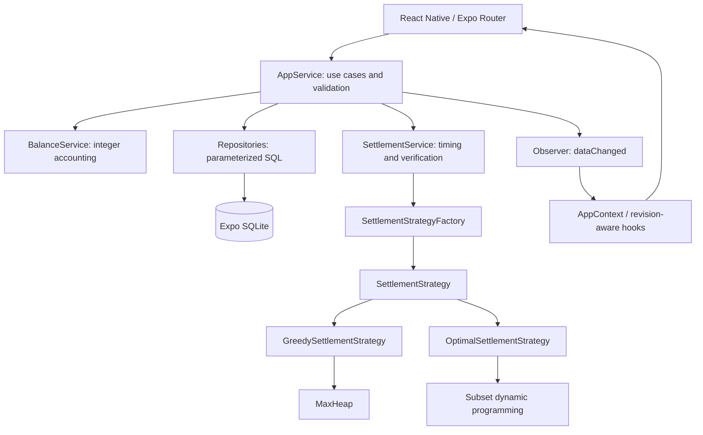
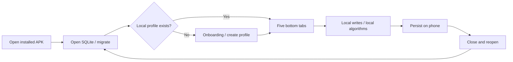
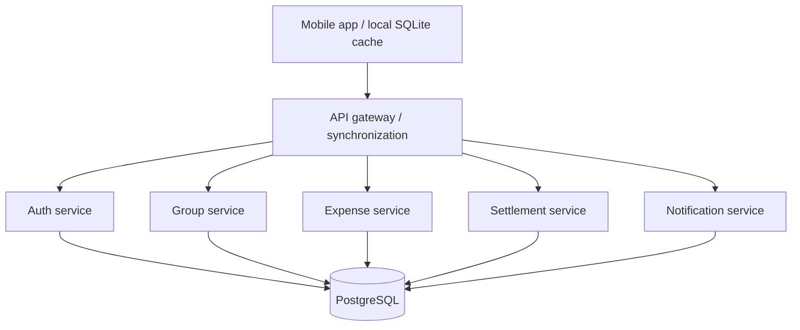

# Architecture and design patterns

## Layers

Screens contain navigation and presentation state. `AppService` coordinates validation, transactions, expense operations, settlement progress, and demo/reset. Read repositories in `src/repositories/Repositories.js` handle groups, members, expenses, settlements, activities, settings, and aggregated dashboard queries. `src/repositories/LedgerRepository.js` provides named transaction-scoped persistence operations. SQL does not appear in screens or business services.

Global context carries the service instance, profile/settings, theme, and a data revision. It does not copy the full database into global state. `useData` refreshes on committed changes and ignores outdated async responses. The dashboard uses SQL aggregates and a limited recent list. Global expense filters are parameterized SQL and history limits increase on demand; activity is similarly bounded. Group detail loads only that group's financial history.

## Database and transactional consistency

`src/database/schema.js` enables foreign keys and WAL before initialization. Schema version 1 is applied in an exclusive transaction. A newer unsupported version raises an error instead of overwriting data. Future versions should add ordered migrations, incrementing `user_version` inside each successful transaction.

Group deletion cascades through associated history. Member deletion is blocked for any expense/participant/payment references. Member names are unique within a group ignoring case, and a partial unique index permits at most one self-linked member per group. All expenses are validated against their group's member IDs. Amounts and shares are INTEGER with positive/nonnegative checks. Additional domain validation checks safe integer totals before writes.

Every use-case mutation uses `withExclusiveTransactionAsync`, publishing the observer event only after commit. Expense participant replacement, audit logging, and plan invalidation commit together or roll back together. Demo loading and reset are also atomic. There are no concatenated user values in SQL.

Groups have balance revisions. Expense edits increment that revision and invalidate all plans. Plan persistence checks its captured revision to reject stale calculations. Recording a paid transaction increments the group revision and the still-active run revision, preserving its remaining valid payments while rejecting calculations made before the payment. A payment correction reverses its ledger effect and invalidates the active plan. Completed payments from older invalid runs continue to adjust balances.

## Strategy Pattern — behavioral

**Problem:** Screens should not know how to match debtors and creditors.

**Use:** `src/strategies/SettlementStrategy.js` declares the calculation interface and shared balance validation. `GreedySettlementStrategy.js` and `OptimalSettlementStrategy.js` implement it. `src/services/SettlementService.js` executes a selected strategy, measures it, and verifies its output. `EqualSplitStrategy.js` is a separate splitting interface ready for future methods.

## Factory Pattern — creational

**Problem:** Construction and method validation otherwise spread across screens.

**Use:** `src/factories/SettlementStrategyFactory.js` exports `createSettlementStrategy('greedy' | 'optimal')`. Unknown identifiers fail explicitly. Adding an algorithm requires registering its construction, not changing every caller.

## Observer Pattern — behavioral

**Problem:** A changed expense affects dashboards, balances, and plans that may already be mounted.

**Use:** `src/events/EventBus.js` is a lightweight subscription mechanism. Successful mutations emit `dataChanged`; `src/context/AppContext.js` increments a revision, and `src/hooks/useData.js` reloads relevant mounted queries. Subscription cleanup avoids leaks. The database remains the authoritative state.

## Command Pattern — behavioral

**Problem:** Expense add/update/delete operations need consistent invocation and an understandable undo boundary.

**Use:** `src/commands/ExpenseCommands.js` defines `AddExpenseCommand`, `UpdateExpenseCommand`, and `DeleteExpenseCommand`, each with `execute` and `undo`. Updates/deletions capture the previous expense including participants. `AppService.execute` stores the last successful command; Settings invokes undo. Undo writes through the same validation and transactional workflow and recalculates/invalidate balances/plans.

Undo is session-local, is cleared by reset/group deletion/payment recording, and does not reverse paid financial records. An undo operation can fail safely if history has changed, rather than corrupting the ledger. It is deliberately not a global event-sourcing system.

## Offline lifecycle

The APK embeds JavaScript and fonts. No runtime network service is required. Development Expo Go/dev-client testing uses Metro; EAS preview builds are standalone. Uninstalling the app can delete the database. Version 1 has no export/restore feature.

## Future online version

Do not add these services to version 1. If multi-device sharing and cloud synchronization become necessary, evaluate an API and sync layer first, then split into services only when operational scale justifies it.

Such a version needs authentication, authorization, stable global IDs, idempotent commands, conflict resolution, currency invariants, backup policies, and a secure synchronization protocol. Local algorithms can remain reusable, with the server validating shared ledger changes. These are future improvements, not dependencies of the offline application.
